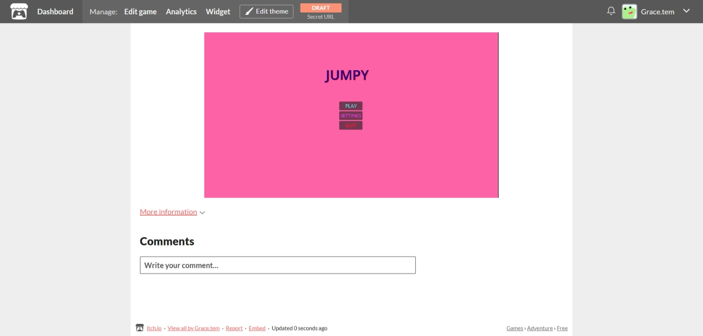

## Jumpy

A small 2D platformer made in Godot. Run, jump, collect coins, dodge slimes, and reach the door to win

## ScreenShot

## Try It
[Demo Link](https://gracetem.itch.io/jumpy)

To try just open the link and try it

## Features
__Main menu__ with settings for volume and fullscreen

__Pause menu__ with resume, settings, and quit

Sound effects and background music

Coin counter and Best score

## Built with
Godot Engine

## Credits
[Grace](https://github.com/Temi-ay)
